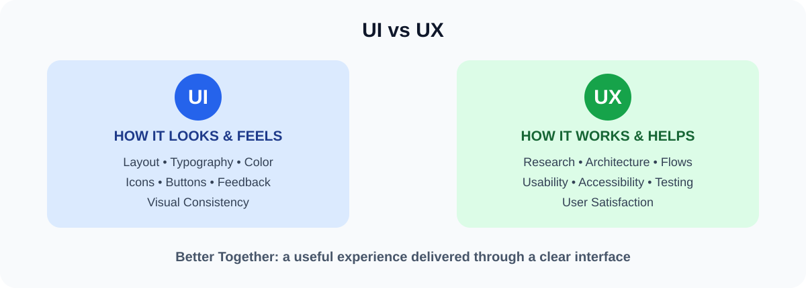
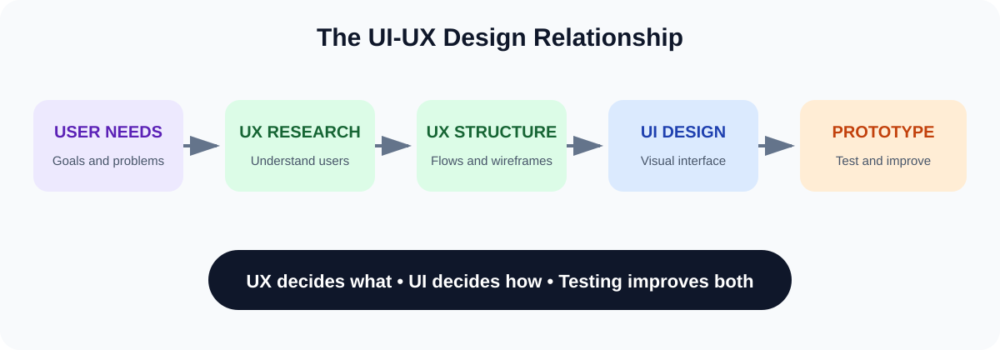
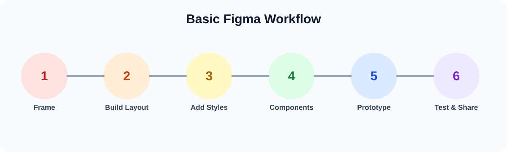

# UI/UX Experiment 1

> **Course:** Unit 1 - Lab Experiments  
> **Experiment:** Hands-on UI/UX Fundamentals

  

## 📌 Aim

To understand the fundamentals of **UI** and **UX**, differentiate them using real-world case studies, illustrate their relationship, and demonstrate commonly used UI/UX design tools.

---

## 🧭 Algorithm

1. Define UI and UX and identify their primary objectives.
2. Select real-world applications for practical case studies.
3. Compare interface and experience characteristics.
4. Create a relationship diagram showing how UI and UX work together.
5. Review the features of popular UI/UX design tools.
6. Demonstrate a basic design workflow using Figma.
7. Summarize observations and conclusions.

---

## 📖 Output

### 1. Fundamentals of UI and UX

<table>
  <tr>
    <td width="50%" valign="top">
      <h4>🎨 User Interface (UI)</h4>
      
UI is the visual and interactive layer through which users communicate with a digital product.

      <ul>
        <li>Layout and spacing</li>
        <li>Typography and colour</li>
        <li>Buttons and icons</li>
        <li>Navigation and forms</li>
        <li>Animation and feedback</li>
      </ul>
      
<strong>Goal:</strong> Make interaction clear, consistent and attractive.

    </td>
    <td width="50%" valign="top">
      <h4>🧠 User Experience (UX)</h4>
      
UX is the complete experience a person has while using a product or service.

      <ul>
        <li>User research and personas</li>
        <li>Information architecture</li>
        <li>User flows and wireframes</li>
        <li>Usability and accessibility</li>
        <li>Testing and satisfaction</li>
      </ul>
      
<strong>Goal:</strong> Make interaction useful, usable and effective.

    </td>
  </tr>
</table>

---

### 2. Comparison: UI vs UX

| Aspect | UI — Interface Design | UX — Experience Design |
|---|---|---|
| **Primary focus** | Visual presentation and interaction | Overall usability and satisfaction |
| **Main concern** | Appearance of screens | The complete user journey |
| **Core elements** | Colour, typography, icons, buttons | Research, personas, flows, wireframes |
| **Key question** | “How should this look and feel?” | “Does this help the user achieve the goal?” |
| **Deliverables** | Mockups, design systems, prototypes | Research findings, journeys, wireframes |
| **Final outcome** | A clear and consistent interface | A useful and usable experience |

---

### 3. Real-World Case Studies

#### 🍔 Swiggy

| UI Observation | UX Observation |
|---|---|
| Large restaurant images, clear category cards and prominent buttons | Nearby restaurant discovery, ratings and delivery estimates |
| Readable prices and consistent navigation | Saved addresses and quick-reorder features reduce effort |

**Evaluation:** The attractive visual interface helps users scan choices quickly, while the organized experience helps them complete an order with fewer steps.

#### 🔎 Google Search

| UI Observation | UX Observation |
|---|---|
| Minimal layout with a central search field | Relevant suggestions and fast results |
| Clean typography and easily recognizable icons | Predictable layout and effortless task completion |

**Evaluation:** The simple interface works because the entire experience is fast, relevant and easy to understand.

#### 🛒 Amazon

| UI Observation | UX Observation |
|---|---|
| Product cards, filters, ratings and a visible cart | Search history, recommendations and wish lists |
| Consistent buttons and a prominent search bar | One-click purchasing and a structured checkout journey |

**Evaluation:** Strong visual consistency is necessary to guide users through Amazon's large and complex shopping experience.

---

### 4. Relationship Between UI and UX

UI and UX are related but not identical. **UX defines the structure and behavior**, while **UI presents that structure visually and interactively**.

  

> A good UX can be weakened by poor UI, while an attractive UI cannot compensate for a confusing or difficult user journey.

**Example:** UX research may determine that users should see nearby restaurants first. UI design then decides how those restaurants are grouped, coloured, labelled and highlighted.

---

### 5. Popular UI/UX Design Tools

| Tool | Category | Key Features |
|---|---|---|
| **Figma** | UI design and prototyping | Components, styles, plugins, multiplayer collaboration |
| **Adobe XD** | UI design and prototyping | Artboards, components, animations and device preview |
| **Sketch** | macOS UI design | Symbols, vector editing, reusable styles and plugins |
| **Balsamiq** | Low-fidelity wireframes | Sketch-style controls for rapid layout exploration |
| **Adobe Illustrator** | Vector graphics | Icons, logos and detailed illustrations |
| **Miro** | UX collaboration | Journey maps, brainstorming and affinity mapping |
| **Canva** | Quick visual presentation | Templates for mockups, posters and presentations |
| **ProtoPie** | High-fidelity prototyping | Advanced gestures and detailed interactions |

---

### 6. Figma Demonstration

Figma is a browser-based tool for interface design and interactive prototyping.

  

#### 🔧 Demonstration Steps

1. Create a new Figma design file.
2. Add a frame for a mobile or desktop screen.
3. Build the layout using shapes, text and icons.
4. Apply consistent typography, colours and spacing.
5. Create reusable components and styles.
6. Use Auto Layout for responsive alignment.
7. Switch to Prototype mode and connect interactions.
8. Preview the prototype and test navigation.
9. Share the file for feedback and collaboration.

---

## ✅ Result

The fundamentals of UI and UX were explored and differentiated using real-world examples. **UI represents the visual and interactive layer**, whereas **UX represents the complete process of making a product useful, usable and satisfying**.

The study also demonstrated that UI and UX are interdependent. Common design tools were reviewed, and Figma was identified as a suitable platform for creating layouts, reusable components and interactive prototypes.
